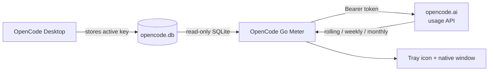

<div align="center">

# OpenCode Go Meter

**A lightweight Windows tray meter for OpenCode Go usage.**

[](https://www.rust-lang.org/)
[](https://www.microsoft.com/windows)
[](LICENSE)
[](#native-window)

[Features](#features) · [Quick start](#quick-start) · [How it works](#how-it-works) · [Build from source](#build-from-source) · [Security](#security)

</div>

---

OpenCode Go enforces three overlapping limits:

| Window | Share of monthly allowance | Resets |
|---|---:|---|
| 5-hour rolling | 20% | 5 hours after first use |
| Weekly | 50% | Monday 00:00 UTC |
| Monthly | 100% | Start of the paid period |

Checking the Console every time breaks focus. **OpenCode Go Meter** stays in the Windows notification area and keeps the numbers one glance away.

> **Native Win32 + Rust.** No Electron, no WebView, no HTML.

## Preview

```text
┌─ OpenCode Go 用量 ────────────────────────────────────┐
│                                                       │
│  5 小时窗口  ·  100%                                  │
│  已用 100%      剩余 0%      已触顶                   │
│  ████████████████████████████████████████████████     │
│  12分钟后重置 · 17:52:13                              │
│                                                       │
│  每周窗口  ·  49%                                     │
│  已用 49%       剩余 51%     正常                     │
│  ███████████████████████░░░░░░░░░░░░░░░░░░░░░░░      │
│  6天后重置 · 周一 08:00                               │
│                                                       │
│  月度额度  ·  35%                                     │
│  已用 35%       剩余 65%     正常                     │
│  █████████████████░░░░░░░░░░░░░░░░░░░░░░░░░░░░░      │
│  10天后重置 · 12-04 06:41                             │
│                                                       │
│  最近更新：2026-11-23 19:35:12                        │
│                         [ 打开 Console ]  [ 关闭 ]    │
└───────────────────────────────────────────────────────┘
```

The tray icon is color-coded from the 5-hour window: **green** below 50%, **amber** from 50% to 79%, **red** at 80% or above, and **grey** when authentication fails.

## Features

| | |
|---|---|
| **Tray-first** | Hover for `5h` and monthly percentages without opening anything. |
| **Right-click menu** | 5-hour, weekly, and monthly details; refresh; open Console; quit. |
| **Double-click window** | Native Win32 window with three progress bars, status, and reset times. |
| **Automatic refresh** | Polls once per minute; manual refresh from the menu or window. |
| **Credential discovery** | Reads the active OpenCode Go credential from OpenCode Desktop's local database. |
| **Read-only by design** | Opens `opencode.db` with `mode=ro`; never writes to OpenCode's data. |
| **Single binary** | ~4 MB release executable; SQLite is bundled, no external runtime. |

## Quick start

### Option A — run the prebuilt executable

1. Download `opencode-go-tray.exe` from the latest release.
2. Place it in a permanent folder.
3. Double-click it. The icon appears in the notification area.

### Option B — build from source

```powershell
git clone https://github.com/VeloxLLM/opencode-go-meter.git
cd opencode-go-meter
.\run-tray.bat
```

`run-tray.bat` builds a release binary on first run, then starts it.

> **Prerequisite:** sign in to **OpenCode Go** in OpenCode Desktop at least once. The app reads the active credential that OpenCode Desktop stores locally.

If the icon is hidden, click the **^** overflow button in the notification area.

## Usage

| Action | Result |
|---|---|
| Hover the tray icon | Tooltip with 5-hour and monthly percentages |
| Right-click | Menu with 5h / weekly / monthly details, refresh, Console, quit |
| Double-click | Native usage window |
| `opencode-go-tray.exe --preview` | Open the usage window directly, without the tray |

The window can be closed normally; the tray process keeps running.

## How it works



The app reads the active credential from:

```text
%USERPROFILE%\.local\share\opencode\opencode.db
table: credential
where: integration_id = 'opencode-go' AND active = 1
```

It then calls the official endpoint:

```http
GET https://opencode.ai/inference/go/v1/usage
Authorization: Bearer <token>
```

Response fields used:

```json
{
  "usage": {
    "rolling": { "status": "ok", "percent": 30, "resetsAt": "..." },
    "weekly":  { "status": "ok", "percent": 49, "resetsAt": "..." },
    "monthly": { "status": "ok", "percent": 35, "resetsAt": "..." }
  }
}
```

### Credential resolution order

1. `OPENCODE_API_KEY` environment variable
2. `OPENCODE_GO_API_KEY` environment variable
3. OpenCode Desktop's SQLite `credential` table

The legacy `auth.json` file is intentionally **not** used; older OpenCode builds stored a provider key there that the current usage endpoint rejects.

## Build from source

**Requirements**

- Windows 10 or 11
- Rust 1.90+ with the `x86_64-pc-windows-msvc` toolchain
- Visual Studio Build Tools with the MSVC linker

```powershell
cargo build --release
.\target\release\opencode-go-tray.exe
```

Run the test suite:

```powershell
cargo test
```

### Dependencies

| Crate | Purpose |
|---|---|
| `tray-icon` | Windows notification-area icon and context menu |
| `winit` | Event loop required by the tray backend |
| `ureq` + `rustls` | HTTPS usage requests |
| `rusqlite` (bundled) | Read-only access to OpenCode's local credential DB |
| `windows-sys` | Native Win32 window, progress bars, and controls |
| `chrono` | RFC 3339 parsing and local reset times |
| `serde_json` | Usage response parsing |

## Autostart (optional)

Register a logon task so the meter starts with Windows:

```powershell
$exe = (Resolve-Path .\target\release\opencode-go-tray.exe).Path
$action = New-ScheduledTaskAction -Execute $exe
$trigger = New-ScheduledTaskTrigger -AtLogOn
Register-ScheduledTask -TaskName OpenCodeGoMeter -Action $action -Trigger $trigger
```

Remove it with:

```powershell
Unregister-ScheduledTask -TaskName OpenCodeGoMeter -Confirm:$false
```

## Security

- The SQLite database is opened with `SQLITE_OPEN_READ_ONLY`; the app cannot modify OpenCode data.
- The API key is held in memory only. It is never logged, written to disk, or sent anywhere except `opencode.ai`.
- No telemetry, analytics, or background network calls beyond the usage endpoint.
- The app does not read chat content, prompts, or session data; only the `credential` row.

## Project layout

```text
.
├─ src/
│  └─ main.rs          # tray, usage API, Win32 window
├─ Cargo.toml
├─ Cargo.lock
├─ run-tray.bat        # build-if-needed launcher
├─ LICENSE
└─ README.md
```

## Roadmap

- [ ] Optional installer with autostart
- [ ] High-DPI polish and dark title bar
- [ ] Multi-workspace / multi-account switching
- [ ] Signed release binaries

## License

MIT © 2026 VeloxLLM
