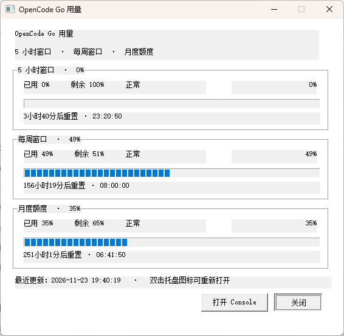
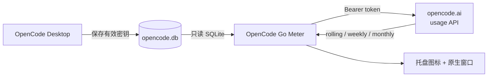

<div align="center">

# OpenCode Go Meter

**Windows 托盘上的 OpenCode Go 用量表。**

[](https://www.rust-lang.org/)
[](https://www.microsoft.com/windows)
[](LICENSE)
[](#它如何工作)

[English](README.md) · 中文

[功能](#功能) · [快速开始](#快速开始) · [它如何工作](#它如何工作) · [从源码构建](#从源码构建) · [安全](#安全)

</div>

---

OpenCode Go 有三层互相叠加的用量限制：

| 窗口 | 占月度额度比例 | 重置规则 |
|---|---:|---|
| 5 小时滚动窗口 | 20% | 首次使用后 5 小时 |
| 每周窗口 | 50% | 每周一 00:00 UTC |
| 月度额度 | 100% | 订阅周期开始时 |

每次都去 Console 查看会打断专注。**OpenCode Go Meter** 常驻 Windows 通知区域，用量一瞥即知。

> **原生 Win32 + Rust。** 没有 Electron、WebView，也没有 HTML。

## 预览



托盘图标颜色随 5 小时窗口变化：**绿色** <50%，**橙色** 50–79%，**红色** ≥80%，认证异常时为**灰色**。

## 功能

| | |
|---|---|
| **托盘优先** | 悬停即可查看 5 小时与月度百分比，无需打开任何窗口。 |
| **右键菜单** | 5 小时 / 每周 / 月度明细、立即刷新、打开 Console、退出。 |
| **双击窗口** | 原生 Win32 窗口，带三条进度条、状态与重置时间。 |
| **自动刷新** | 每分钟轮询一次，支持手动刷新。 |
| **自动发现凭据** | 从 OpenCode Desktop 本地数据库读取当前有效的 OpenCode Go 凭据。 |
| **只读设计** | 以 `mode=ro` 打开 `opencode.db`，绝不写入 OpenCode 数据。 |
| **单文件** | 约 4 MB 发布版可执行文件，SQLite 已打包，无外部运行时。 |

## 快速开始

### 方式 A — 使用预编译程序

1. 从最新 Release 下载 `opencode-go-tray.exe`。
2. 放到一个固定目录。
3. 双击运行，图标会出现在通知区域。

### 方式 B — 从源码构建

```powershell
git clone https://github.com/VeloxLLM/opencode-go-meter.git
cd opencode-go-meter
.\run-tray.bat
```

`run-tray.bat` 会在首次运行时构建发布版，然后启动程序。

> **前提**：请先在 OpenCode Desktop 中登录 OpenCode Go。程序读取的是 OpenCode Desktop 本地保存的当前有效凭据。

若托盘图标被隐藏，请点击通知区域的 **^** 展开按钮。

## 使用方式

| 操作 | 效果 |
|---|---|
| 悬停托盘图标 | 显示 5 小时与月度百分比 |
| 右键 | 5 小时 / 每周 / 月度明细、刷新、打开 Console、退出 |
| 双击 | 打开原生用量窗口 |
| `opencode-go-tray.exe --preview` | 直接打开用量窗口，不启动托盘 |

窗口可以正常关闭；托盘进程继续常驻。

## 它如何工作



程序从以下位置读取当前有效凭据：

```text
%USERPROFILE%\.local\share\opencode\opencode.db
表：credential
条件：integration_id = 'opencode-go' AND active = 1
```

随后调用官方接口：

```http
GET https://opencode.ai/inference/go/v1/usage
Authorization: Bearer <token>
```

使用的响应字段：

```json
{
  "usage": {
    "rolling": { "status": "ok", "percent": 30, "resetsAt": "..." },
    "weekly":  { "status": "ok", "percent": 49, "resetsAt": "..." },
    "monthly": { "status": "ok", "percent": 35, "resetsAt": "..." }
  }
}
```

### 密钥解析顺序

1. 环境变量 `OPENCODE_API_KEY`
2. 环境变量 `OPENCODE_GO_API_KEY`
3. OpenCode Desktop 的 SQLite `credential` 表

旧的 `auth.json` 故意**不使用**：早期版本把 provider 密钥写在那里，当前用量接口会拒绝。

## 从源码构建

**环境要求**

- Windows 10 或 11
- Rust 1.90+，目标三元组 `x86_64-pc-windows-msvc`
- Visual Studio Build Tools（含 MSVC 链接器）

```powershell
cargo build --release
.\target\release\opencode-go-tray.exe
```

运行测试：

```powershell
cargo test
```

### 依赖

| Crate | 用途 |
|---|---|
| `tray-icon` | Windows 通知区域图标与右键菜单 |
| `winit` | 托盘后端所需事件循环 |
| `ureq` + `rustls` | HTTPS 用量请求 |
| `rusqlite`（bundled） | 只读访问本地凭据数据库 |
| `windows-sys` | 原生 Win32 窗口、进度条与控件 |
| `chrono` | RFC 3339 解析与本地重置时间 |
| `serde_json` | 用量响应解析 |

## 开机自启（可选）

注册登录任务，让程序随 Windows 启动：

```powershell
$exe = (Resolve-Path .\target\release\opencode-go-tray.exe).Path
$action = New-ScheduledTaskAction -Execute $exe
$trigger = New-ScheduledTaskTrigger -AtLogOn
Register-ScheduledTask -TaskName OpenCodeGoMeter -Action $action -Trigger $trigger
```

移除：

```powershell
Unregister-ScheduledTask -TaskName OpenCodeGoMeter -Confirm:$false
```

## 安全

- SQLite 数据库以 `SQLITE_OPEN_READ_ONLY` 打开，程序无法修改 OpenCode 数据。
- API Key 仅保存在内存中，不会被写入磁盘或发送到 `opencode.ai` 之外的任何地方。
- 无遥测、无统计上报，除用量接口外无其他后台请求。
- 不读取会话内容、提示词或聊天数据；只读 `credential` 表中的凭据。

## 项目结构

```text
.
├─ assets/
│  └─ preview.png       # README 截图
├─ src/
│  └─ main.rs           # 托盘、用量 API、Win32 窗口
├─ Cargo.toml
├─ Cargo.lock
├─ run-tray.bat         # 构建并启动脚本
├─ LICENSE
├─ README.md            # 英文
└─ README.zh-CN.md      # 中文
```

## Roadmap

- [ ] 可选安装器与自启动
- [ ] 高 DPI 优化与深色标题栏
- [ ] 多工作区 / 多账号切换
- [ ] 签名的 Release 二进制

## License

MIT © 2026 VeloxLLM
